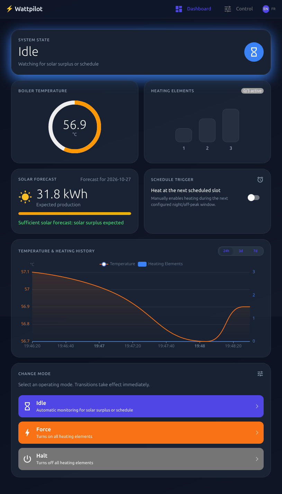

# Wattpilot

**Intelligent water boiler controller optimizing photovoltaic (PV) auto-consumption with multi-stage resistance heating and weather forecasts.**

[](https://github.com/lostcontrol/wattpilot/actions/workflows/ci.yml)

[](https://github.com/astral-sh/ruff)
[](https://www.gnu.org/licenses/old-licenses/gpl-2.0.html)

---



## Overview

Domestic hot water boilers represent one of the largest single electrical energy consumers in a typical household. Traditionally, boilers heat water overnight during fixed off-peak hours using 100% grid electricity.

With solar photovoltaic (PV) systems, homeowners frequently export excess electricity to the grid at low feed-in tariffs. Commercial continuous-modulation controllers (such as the Fronius Ohmpilot) are expensive and lack predictive awareness of future weather.

**Wattpilot** provides a lightweight, cost-effective, DIY solution. Instead of continuously modulating power via expensive thyristor electronics, it discretely switches multiple heating elements (typically 3 electrical resistances, e.g. 3 × 1,333 W) based on:

1. **Real-Time Solar Surplus**: Exported power measured directly from Fronius inverters.
2. **Predictive Solar Forecasts**: Solar energy production forecast retrieved from Forecast.Solar.
3. **Scheduled Off-Peak Windows**: User-defined off-peak heating periods with midnight wrap-around.
4. **Target Temperatures & Hysteresis**: Independent temperature setpoints for solar, scheduled, and forced modes.

---

## Features

- **⚡ Multi-Stage Load Switching**: Dynamically steps through 1 to $N$ heating elements according to instantaneous solar export, maximizing self-consumption without expensive variable-power hardware.
- **☀️ Real-Time Solar Surplus Tracking**: Directly queries the Fronius Solar API to detect surplus generation and adjust active boiler loads on the fly.
- **🌤️ Predictive Solar Forecasting**: Queries [Forecast.Solar](https://forecast.solar/) for estimated daily solar production (in kWh) tailored to the PV installation's size, tilt, and azimuth. During the scheduled window, real-time solar surplus takes precedence; otherwise, if sufficient solar production is forecast, grid heating is suppressed to reserve boiler capacity for solar auto-consumption. If estimated solar production is low (below a configurable minimal kWh threshold), backup grid heating engages to ensure the target temperature is reached.
- **⏱️ Flexible Off-Peak Schedule**: Configurable schedule window with full support for midnight wrap-around (e.g. 23:00 to 02:00) and an interactive 24-hour visual timeline.
- **🌡️ Granular Temperature Setpoints**: Set distinct boiler target temperatures for solar surplus, scheduled off-peak, and manual force heating (45.0 °C to 65.0 °C in 0.5 °C steps) with automatic temperature hysteresis.
- **📱 Modern Reactive Dashboard**: Sleek web interface built with [NiceGUI](https://nicegui.io/), featuring live temperature gauges, heating element indicators, one-click mode switching, and bilingual localization (English & French).
- **📊 PVOutput Telemetry**: Built-in support to stream temperature and power telemetry to [PVOutput](https://pvoutput.org/).
- **🐳 Docker & Raspberry Pi Native**: Runs in Docker with simulated devices for local testing or directly on Raspberry Pi hardware using GPIO and 1-Wire DS18B20 sensors.

---

## Architecture

Wattpilot is built using the [Pykka](https://www.pykka.org/) actor model for concurrent, non-blocking hardware control:

- **`WattPilot`**: Core actor governing the boiler state machine (`idle`, `solar`, `schedule`, `force`, `halt`).
- **`Fronius`**: Inverter interface polling grid export metrics.
- **`ForecastSolar`**: Client fetching daily solar energy production forecasts from Forecast.Solar.
- **`Temperature`**: Polling actor for 1-Wire DS18B20 temperature sensors.
- **`PVOutput`**: Telemetry actor transmitting live status to PVOutput.
- **`FrontendApp` & `BackendService`**: Decoupled, reactive NiceGUI application interfacing via actor proxies.

---

## Getting Started

### Prerequisites

- Python 3.15+
- [`uv`](https://docs.astral.sh/uv/) package manager
- (Optional) Docker and Docker Compose

### Local Development (Simulated Hardware)

Clone the repository and install dependencies:

```bash
git clone https://github.com/lostcontrol/wattpilot.git
cd wattpilot
uv sync
```

Launch Wattpilot in simulated device mode:

```bash
uv run python wattpilot.py --fake-devices
```

Open [http://localhost:8080](http://localhost:8080) in your browser.

### Docker Deployment

#### Standard Production Container

```bash
docker compose up -d
```
Access the dashboard at [http://localhost](http://localhost) (port 80).

#### Development Container

```bash
docker compose -f docker-compose.development.yml up
```
Access the development interface at [http://localhost:8088](http://localhost:8088).

#### Raspberry Pi Hardware Deployment

```bash
docker compose -f docker-compose.rpi.yml up -d
```
Maps `/dev/gpiochip0` for native GPIO pin control via `rpi-lgpio`.

---

## Configuration

Wattpilot uses a 3-tier cascading INI configuration system where later files override earlier ones:

1. **`config.ini`**: Base defaults tracked in git.
2. **`config.ini.local`**: Local site configuration, hardware pins, API keys, and inverter IP addresses (gitignored).
3. **`config.ini.settings`**: Runtime UI settings persisted by the web interface (highest priority). The file path can be customized via the `WATTPILOT_SETTINGS` environment variable.

### Example `config.ini.local`

Create a `config.ini.local` file to specify your hardware and credentials:

```ini
[main]
hysteresis_to_grid = 500
hysteresis_from_grid = 0
fronius_host = 192.168.1.50
solar_threshold = 15.0

[temperature]
address = 28-0416350909ff

[forecastsolar]
latitude = 46.2044
longitude = 6.1432
declination = 20
azimuth = 30
kwp = 10.240

[pvoutput]
key = YOUR_PVOUTPUT_API_KEY
sid = YOUR_PVOUTPUT_SYSTEM_ID
field = v12

[load_1]
power = 1333
pin = 26

[load_2]
power = 1333
pin = 20

[load_3]
power = 1333
pin = 21
```

---

## Web Interface

The web interface is decoupled under the `frontend/` directory and delivers an intuitive, mobile-optimized experience:

- **Dashboard**:
  - Live system state badge (`En attente / Idle`, `Solaire / Solar`, `Programmé / Schedule`, `Forcer / Force`).
  - Circular water temperature gauge with live readings.
  - Multi-stage heating element status indicators.
  - Upcoming solar production forecast preview in kWh and schedule decision badge.
  - One-click trigger for the upcoming off-peak scheduled period.
  - Fast mode switcher (Attente, Forcer, Arrêter).
- **Control Page**:
  - Adjust target temperatures for solar surplus, scheduled heating, and force mode (45.0 °C to 65.0 °C in 0.5 °C steps).
  - Set off-peak schedule start and stop hours with immediate 24-hour visual period rendering.
  - Set minimum solar forecast threshold to automatically skip off-peak heating when sunny weather is expected.
  - Settings are validated and written directly to the persistent settings file.
- **Internationalization**:
  - Full English and French support (`frontend/locales/en.json` and `frontend/locales/fr.json`).
  - Automatic language detection with preference stored in client-side cookies (`wattpilot_lang`).

---

## Development & Testing

### Running Tests

Execute the unit and integration test suite:

```bash
uv run pytest -v -s --cov=wattpilot --cov-report term test/
```

### Code Formatting & Type Checking

Run all pre-commit hooks:

```bash
uv run pre-commit run --all-files
```

Or run tools individually:

```bash
uv run ruff check --fix .
uv run ruff format .
uv run ty check
```

---

## License

This project is licensed under the terms of the [GNU General Public License v2 (GPL-2.0)](LICENSE).
